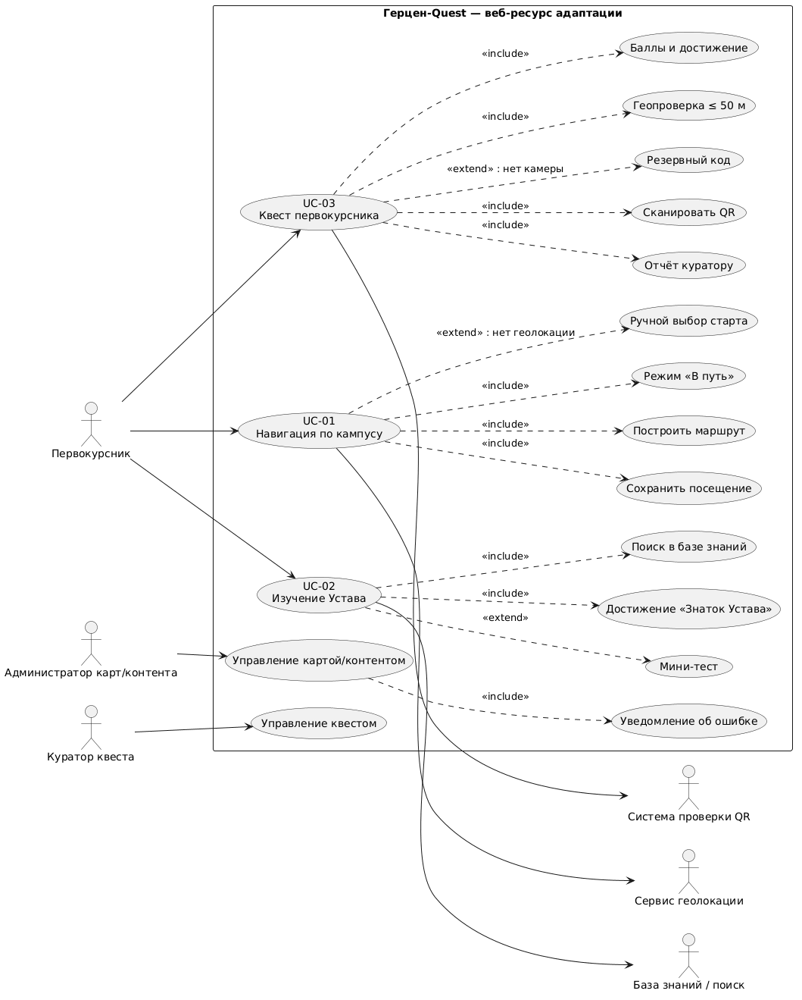
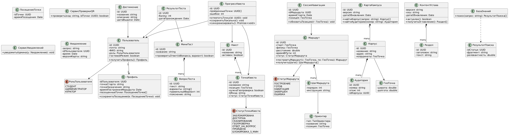
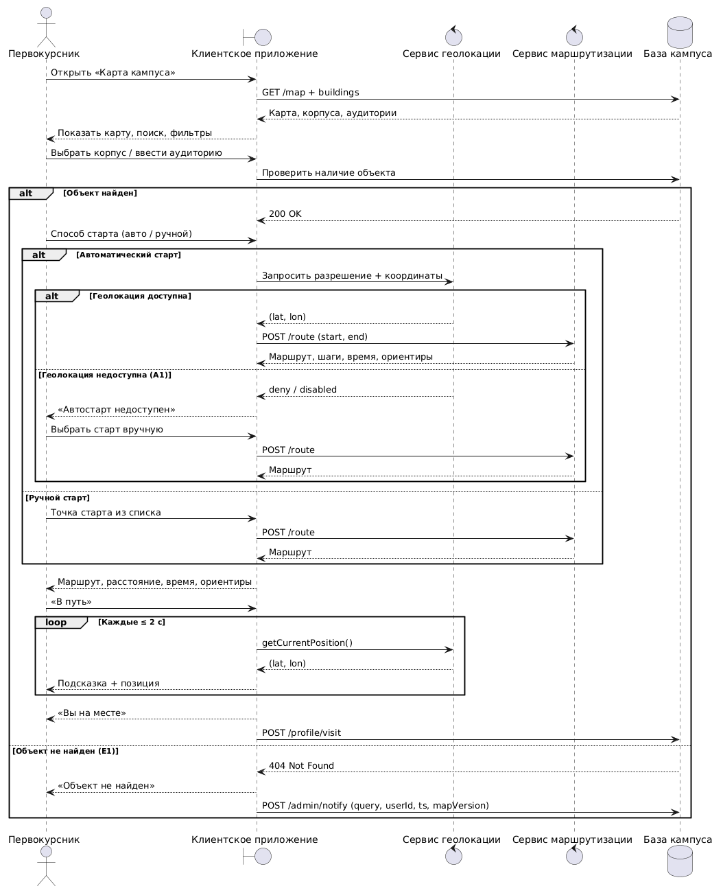
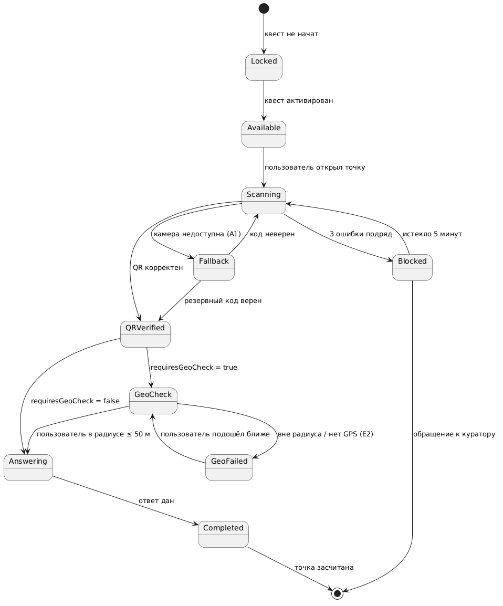
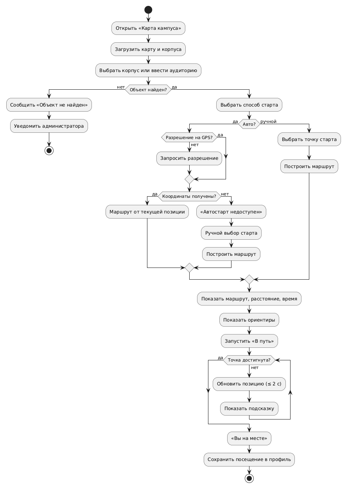

# UML-диаграммы

**Тема ВКР:** Разработка игрового веб-ресурса для адаптации первокурсников РГПУ им. А. И. Герцена («Герцен-Quest»).

**Предметная область:** веб-платформа с геймификацией для навигации по кампусу (UC-01), изучения Устава (UC-02) и прохождения квестов (UC-03).

---

### 1. Диаграмма вариантов использования (Use Case)
Отражает функциональные границы системы и роли (Первокурсник, Администратор, Куратор, внешние сервисы).

🔗 [Ссылка на код](./use-case.puml)

---

### 2. Диаграмма классов (Class)
Статическая структура данных. По данной диаграмме сгенерирован код на TypeScript для frontend/backend.

🔗 [Ссылка на код](./classes.puml)

---

### 3. Диаграмма последовательности (Sequence)
Динамика построения маршрута (UC-01), включая альтернативу А1 (нет GPS) и исключение E1 (объект не найден).

🔗 [Ссылка на код](./sequence-route.puml)

---

### 4. Диаграмма состояний (State)
Жизненный цикл точки квеста (UC-03): от блокировки до успешного прохождения с учетом геопроверки и ввода резервных кодов.

🔗 [Ссылка на код](./state-quest-point.puml)

---

### 5. Диаграмма деятельности (Activity)
Алгоритм работы навигации (UC-01) с ветвлениями выбора способа старта и циклом пошагового сопровождения.

🔗 [Ссылка на код](./activity-route.puml)

---

### Примерный интерфейс для телефона

